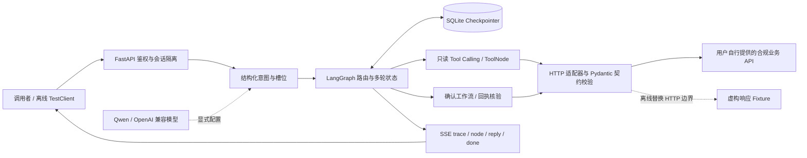

# 电商小二 Agent · v0.9.0 Preview

面向电商客服的 **LangGraph Agent 核心工程作品**：将模型意图识别、工具调用、多轮任务、严格确认、状态恢复与可复核评估组合起来。

本公开版本是精简核心快照，适合阅读代码、运行离线示例和工程回归。**不包含 Vue 页面、电商业务服务器、MySQL 部署或真实业务数据。** 离线示例中的模型和业务响应都是明确标注的虚构替身，不能证明真实 Qwen 或真实交易链路通过。

## 解决的问题与边界

- 订单、物流和商品资料以工具响应为事实依据；识别意图与槽位后验证目标和返回结构。
- 缺少参数时补问；维护未完成任务、任务切换、取消与多轮上下文。
- 催发货与退款申请通过确定性工作流获取严格确认，保留请求 ID、回执核验和结果未知时的恢复逻辑；写操作不直接暴露给模型。
- API 身份来自服务端配置，聊天记录按认证用户和会话隔离；外部业务服务还必须独立执行订单归属、幂等与事务校验。
- SQLite Checkpointer、消息去重、Trace ID、节点/模型/工具/API 时长与可用 Token 用量可观测。

退款申请不等于退款到账；商品接口查询不是完整 RAG；SSE 输出节点进度和最终回复，不是逐 Token 流式输出。本快照不验证外部服务的 MySQL 行锁、并发写入或事务回滚。

## 架构与完整核心调用链



真实模型路径：消息 → Qwen 结构化识别 → LangGraph → Tool → HTTP → 响应校验 → 回复。外部业务 API 和其数据库不在此仓库；离线示例运行真实 Graph/Tool/校验/持久化，用确定性模型输出和 HTTP 响应替身替换两个边界。

## 运行离线示例（首次安装需要网络）

需要 Python 3.12；以下步骤从仓库根目录执行，不需要 API Key、MySQL、访问令牌或 `.env`：

```bash
python3.12 -m venv .venv
.venv/bin/python -m pip install -r requirements.lock
.venv/bin/python customer-service-backend/scripts/test_all.py
.venv/bin/python customer-service-backend/examples/offline_demo.py
cd customer-service-backend/evaluation/holdout_v1
../../../.venv/bin/python -m unittest test_holdout -v
```

示例通过进程内 FastAPI TestClient 依次执行：缺少订单号 → 补充虚构订单 → 查询虚构物流。输出实际 SSE 事件、Trace ID 和节点耗时，并检查另一个用户看不到聊天历史、第二个 SQLite saver 可读取保存状态。所有令牌运行时随机生成且不输出，临时 Checkpointer 用完删除。模型与 HTTP 边界禁止真实写请求；未报告 Token 时保持 unknown，不伪报零消耗。

这不是浏览器验收，也不是实际网络传输测试。示例订单是 `DEMO_ORDER_1`，运单号 `FIXTURE-TRACK-1`，均为虚构。

## Docker（仅核心离线验收）

```bash
docker build -t ecommerce-agent-core:0.9.0-preview .
docker run --rm --network none --read-only --tmpfs /tmp ecommerce-agent-core:0.9.0-preview
docker run --rm --network none --read-only --tmpfs /tmp ecommerce-agent-core:0.9.0-preview \
  python customer-service-backend/examples/offline_demo.py
```

本轮完整 Docker 构建受 PyPI 下载超时阻塞，尚未完成容器运行验收；以下命令是待复核入口，不是已通过声明。

没有 Compose、端口发布、宿主目录/数据库挂载或默认业务服务器。测试通过临时 SQLite 验证状态，不写现有业务库；模型和 HTTP 真实网络边界均不使用。

## 可选：接入自己的模型与业务服务

`.env.example` 仅描述配置，程序不会自动搜索或读取 `.env`。通过安全环境变量设置 `LLM_MODEL`、`LLM_BASE_URL`、`LLM_API_KEY`；不要将任何 Key 提交或放进日志。模型客户端 temperature=0，默认 timeout=30 秒、max_retries=1。

订单等完整链路还需实现 [业务契约](docs/CONTRACTS.md)，设置 `ECOMMERCE_API_BASE_URL`，配置 `AGENT_AUTH_TOKENS_JSON` 为“随机访问令牌 → 合法用户 ID”的映射。业务 API 必须自己验证相同认证身份、订单归属与事务，不能只信任 Agent 传来的订单号。

仅监听回环地址启动 Agent：

```bash
export PYTHONPATH=customer-service-backend
# 先安全配置上述模型、业务 API、鉴权环境变量，再执行：
.venv/bin/python -m uvicorn my_agent.app:app --host 127.0.0.1 --port 18090
```

`/health` 可检查存活；`/api/me`、`/api/chat`、`/api/chat/stream`、`/api/chat/history` 等需要鉴权。鉴权缺配置会拒绝服务。HTTP 客户端需持有 UUID 会话 ID/消息 ID，收到结果未知或断流时保留原消息 ID 核实，不能自动重放写意图。默认 SQLite 位于 backend/data，可用 `AGENT_CHECKPOINT_PATH` 指定新路径；不要复用已有业务 Checkpointer。

## Evaluation 与本版本证据

保留 58 条开发场景、24 条/38 轮留出输入和独立标签、严格断言评分器、工具参数比对、独立指标分母、覆盖率、失败记录、耗时/Token 统计及 Wilson 区间计算。

- 开发集执行器只给 adapter 输入，不传预期答案；同进程接口隔离不是操作系统安全沙箱。
- 留出输入与标签分文件，输入校验拒绝标签注入；**本快照不包含原 MySQL 执行 worker**。评分器接受外部实际记录，评分模式默认不声称真实模型/MySQL。
- 意图级真实模型执行可显式使用 `my_agent.evaluate_adapter:predict_intent`；需要用户自行配置模型并承担调用成本。该 adapter 不具备完整任务成功率的业务证据。

```bash
# 仅在自行配置模型并明确接受调用后运行；下面不是离线测试步骤。
PYTHONPATH=customer-service-backend .venv/bin/python \
  customer-service-backend/evaluation/evaluate_agent.py \
  --adapter my_agent.evaluate_adapter:predict_intent --mode live-intent \
  --capabilities intent slots --limit 1 --output-prefix artifacts/intent-run
```

本快照已重新运行：核心 **98/98**（96 项适用旧测试 + 2 项新增）、留出 schema/评分器 **8/8**。详情和容器验证状态见 [验证记录](docs/VALIDATION.md)。这些是离线工程测试，不是 106 条真实模型场景准确率。历史完整系统的 98/20/前端/MySQL 测试及 56/58、24/24 结果均不作为本快照成绩；本轮未重跑真实模型评测，未测真实 MySQL/浏览器。

场景设计者了解开发类别与已知缺陷；新增样本不是统计独立的生产分布。留出集已公开且被阅读，今后只能作为公开回归集，不能继续称为新的盲测集。

## 代码导航与技术取舍

| 路径 | 职责 |
|---|---|
| `customer-service-backend/my_agent/graph.py` | 保留 LangGraph 拓扑与工具循环 |
| `intent.py` / `prompts.py` / `tool_calling.py` | 结构化分类、槽位、模型工具协议 |
| `state.py` / `task_transition.py` / `checkpoint.py` | 多轮任务、切换与持久化 |
| `shipping_workflow.py` / `refund_workflow.py` | 严格确认、请求标识、回执及结果未知恢复 |
| `contracts.py` / `api_client.py` / `tools.py` | 接口形状、目标校验、错误分类与工具边界 |
| `security.py` / `runtime.py` / `app.py` | 认证、会话隔离、消息去重与 SSE |
| `telemetry.py` / `audit.py` | 安全 Trace、延迟、用量与工具证据 |
| `evaluation/` / `tests/` / `examples/` | 评分方法、离线回归和可运行核心示例 |

详细 [架构与面试复盘](docs/ARCHITECTURE.md)。模型只提出意图和只读工具调用，写路径受确定性状态机控制；SQLite 保持部署简单，但进程内锁不提供多副本分布式互斥。服务端业务事务与幂等仍是外部 API 的责任。

## 来源、发布范围与 E1–E6

项目有课程学习背景。本公开树已排除课程框架、流程模板、原 Vue 页面、电商后端、SQL、图像及衍生截图，也排除依赖它们的私有部署/评测执行入口。保留文件经过逐项引入记录、跨文件片段对照、依赖及实现内容复核；没有以“不在课程目录”作为原创依据。见 [来源说明](docs/PROVENANCE.md) 与 [第三方声明](NOTICE.md)。不提供无来源保证，也不对课程内容追加开源授权。

E1–E6 原里程碑不变；本次精简发布不意味着全部完成：

| 阶段 | 本公开快照边界 |
|---|---|
| E1/E2 | 提供问题背景与接口边界；课程业务实现不发布 |
| E3 | Agent 核心、Tool Calling、多轮与 SQLite 状态在离线回归中验证 |
| E4 | 保留工作流客户端与安全协议；真实业务 API/数据库闭环未在本快照验收 |
| E5 | 保留 FastAPI/SSE；无 Vue UI；浏览器、WebSocket、运营中台未实现或未验收 |
| E6 | 提供核心离线 Docker 入口；无完整 Compose、生产部署、TLS 或公网运维验收 |

目前不发布浏览器截图，避免使用来源不明界面及其衍生素材。GitHub 仓库创建、Push、版本标签均需仓库所有者最终确认。尚未选定项目整体开源许可证，公开可阅读不代表无限制再分发；第三方依赖遵守其各自许可。
